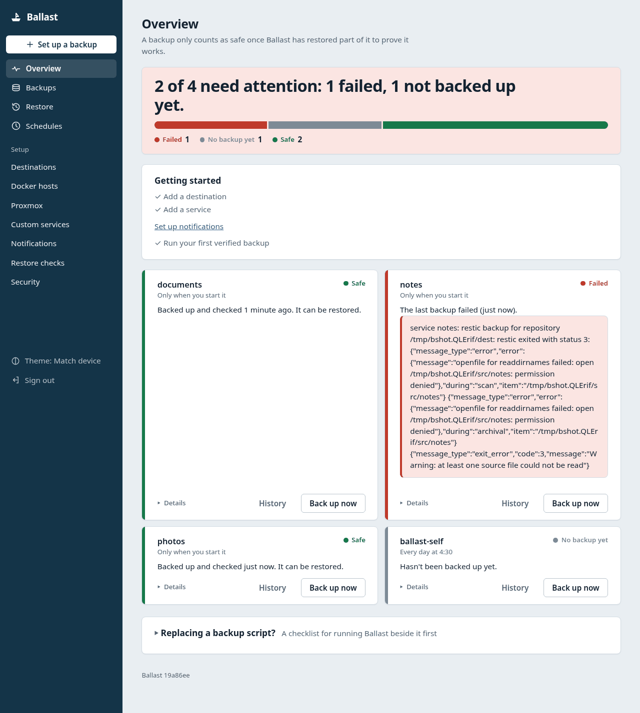
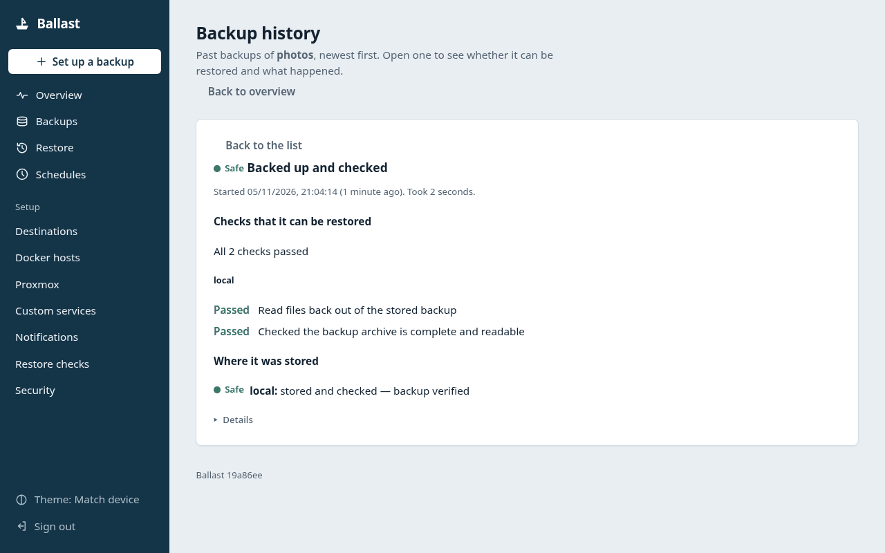
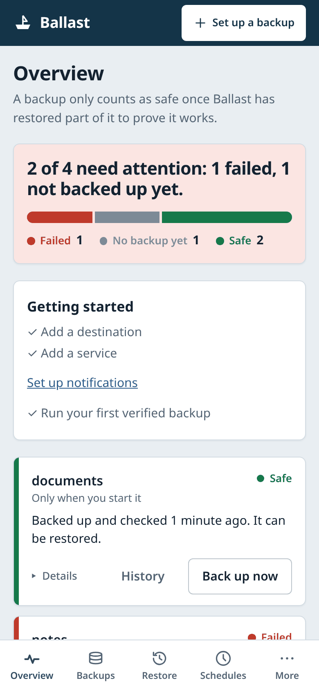

# Ballast

Ballast is a self-hosted backup tool for homelabs, whether you run things on bare metal, in Docker or on Proxmox. It backs up the apps you run in Docker (Immich, Vaultwarden, Postgres, MySQL, CouchDB, Gitea), folders and settings on your machines, and whole Proxmox VMs and LXC containers. It encrypts and stores the backups with [restic](https://restic.net) on local disk or a cloud destination (Backblaze B2, S3, Cloudflare R2, SFTP), or uses Proxmox's own `vzdump` for whole guests, and then checks that each backup can really be restored before it calls the job done. Each service gets a simple green, amber or red status, and Ballast can tell you through ntfy or a webhook when something needs attention. It is one static Go binary with a built-in web UI. No telemetry, no tracking.

## Status: alpha

Ballast is **alpha** software. It is in daily use by its author on a personal homelab, but it has not had wide testing. Expect rough edges, and do not make it your only backup yet.

- What exists: the restic tier (local, B2, S3 and SFTP destinations), the per-service strategies in the catalog, and the restore checks described below. How much each destination type has been used in real life varies, and local and B2 have seen the most use, so test a restore before you rely on any of them.
- Not included: no mobile app and no phone backup. A mobile-friendly web UI is included.
- Not included: only the restic tier exists. A second tier using rclone is planned but not built.
- Only the latest release is supported.

## Install

**Build from source (the working way today).** You need `git`, `make`, Go 1.25 or newer, and restic 0.17.0 or newer on your `PATH`. The web UI is already built into the repository, so Node is not needed.

```bash
git clone https://github.com/springledev/ballast.git
cd ballast
make build
sudo install bin/ballast /usr/local/bin/ballast
```

**Release downloads and the Docker image are not published yet.** [RELEASING.md](RELEASING.md) describes how linux amd64 and arm64 archives are built, and the [Dockerfile](Dockerfile) builds an image from source. Neither is published yet, so build from source for now.

For your first backup after installing, follow the [quickstart](docs/quickstart.md).

## Why it is different

Most backup tools tell you a job "succeeded" when the files were copied. That says nothing about whether you can get your data back. Ballast does not mark a backup done until it has been verified:

- Database dumps are restored into a throwaway container and checked.
- Archives are read back and tested for integrity.
- restic reads back a sample of what it stored.

If Ballast cannot prove a backup restores, it shows **amber**, not green.

- Green: backed up and verified to restore.
- Amber: backed up, but Ballast could not prove it restores.
- Red: something failed.

## How verification works

A backup file sitting in a folder does not prove you can get your data back. Ballast reads the backup back and checks it before it calls the job done. Which checks run depends on the service, but at least one of these always runs:

- **Read files back.** Ballast asks restic to pull a sample of the stored files out of the backup. This also shows the backup is really in the destination.
- **Archive check.** Ballast checks that each archive file is complete and can be read from start to end.
- **Test restore of a database.** For a database dump, Ballast starts a fresh, throwaway container running the same database software, restores the dump into it, and checks that it starts with no real errors. Then it deletes the container.

The result is one of these colours:

- **Green** (shown as **Safe** in the web UI): the backup was made and checked, so it can be restored.
- **Amber** (shown as **Not checked**): the backup was made, but Ballast could not check it. Treat it as no backup until it turns green.
- **Red** (shown as **Failed**): the backup itself did not work.

A service that has never been backed up shows as **No backup yet** in the web UI.

Each destination is reported on its own, so a problem with one copy never hides the result for another. The History page for a service lists each run, each check that was done, and the reason for any amber or red result.

## Supported services

These come from the built-in catalog in [`catalog/`](catalog/). Catalog entries are plain YAML, so adding a service does not need Go code (see [docs/catalog-contributing.md](docs/catalog-contributing.md)).

- **Immich**: photos and videos (Postgres database and photo library)
- **Vaultwarden**: password manager (briefly stopped while its data folder is copied)
- **CouchDB**: CouchDB database (briefly stopped while its data folder is copied)
- **Gitea**: git server (repositories, database and settings in one verified zip)
- **PostgreSQL (generic)**: any PostgreSQL server running in a Docker container
- **MySQL / MariaDB (generic)**: any MySQL or MariaDB server running in a Docker container
- **MySQL / MariaDB (one database, as an app user)**: a single database dumped with the app's own user and password
- **Docker volume (stopped while copied)**: a Docker volume, with its container briefly stopped so the copy is consistent
- **Docker volume (live, no downtime)**: a Docker volume while it stays in use; best for files that rarely change
- **Docker Compose config**: a Compose project's docker-compose.yml, .env and container labels
- **Any folder**: any folder on this machine, no database involved
- **Files from another machine**: chosen config files from another machine over SSH, read-only
- **This machine's settings**: systemd units, scripts in /usr/local/bin and a few system files, to help rebuild the machine

## Quickstart

You need Linux, [restic](https://restic.readthedocs.io/en/stable/020_installation.html) 0.17.0 or newer (for example `sudo apt install restic`), and Docker if you back up Docker services. To build from source you also need Go 1.25. The web UI is already built and committed in `web/dist`, so Node is only needed if you change the web sources.

```bash
git clone https://github.com/springledev/ballast.git
cd ballast
make build              # writes bin/ballast
sudo bin/ballast wizard # guided setup and your first verified backup
```

To rebuild the web UI (needs Node and npm):

```bash
make web
make build
```

Other useful commands:

```bash
bin/ballast version        # print the version
bin/ballast doctor         # check restic, Docker hosts, destinations, disk space
bin/ballast status         # show backup status (add --check for a script-friendly exit code)
bin/ballast runs <service> # past backups of one service (the web UI calls this History)
bin/ballast cancel <service> # stop a running backup; the last good backup is kept
bin/ballast serve          # serve the web UI and REST API
bin/ballast --help         # all commands
```

The full walkthrough is in [docs/quickstart.md](docs/quickstart.md).

## Documentation

- [Quickstart](docs/quickstart.md): your first backup
- [Configuration](docs/configuration.md): services and destinations
- [Systemd setup](docs/systemd.md): run backups automatically
- [Docker hosts](docs/docker-hosts.md): back up containers on other machines
- [Proxmox](docs/proxmox.md): guests and the services inside them
- [Replacing a backup script](docs/replace-a-script.md): move over from a shell script without a gap
- [Adding services to the catalog](docs/catalog-contributing.md)
- [Upgrading](docs/upgrading.md): replace the program safely and go back if needed
- [Migrating from v0.1](docs/migrating.md)

## Screenshots



*Overview: one service failed, one has no backup yet, and two are safe. The demo instance uses sample folders.*



*Backup history: the restore checks for one run of the photos service. The demo instance uses sample folders.*



*The overview at phone width. The demo instance uses sample folders.*

## Contributing and security

See [CONTRIBUTING.md](CONTRIBUTING.md). To report a vulnerability, see [SECURITY.md](SECURITY.md).

Ballast's shared libraries live in keel: https://github.com/springledev/keel

## Licence

Apache-2.0. See [LICENSE](LICENSE).

## Support the project

Ballast is free. If it is useful to you, you can [sponsor the work on GitHub](https://github.com/sponsors/springledev).
